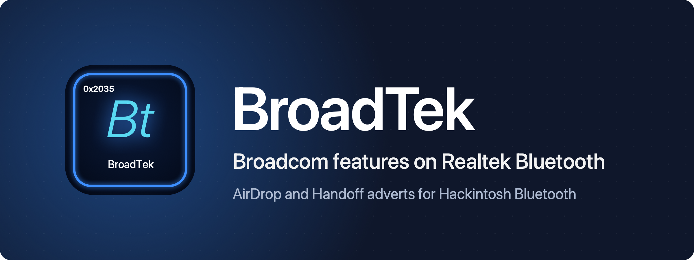

<p align="center">
  
  
  
  
</p>

# BroadTek

**Broadcom features on Realtek Bluetooth.** A Lilu plugin that makes a
Hackintosh's Bluetooth behave the way macOS expects of a Mac's own Broadcom
chip, so that an iPhone can find the Mac for **AirDrop** and **Handoff**.

Apple's `bluetoothd` treats any Bluetooth controller it does not know as a
"third-party dongle" and quietly leaves things out for it. Two of those
decide whether an iPhone ever sees the Mac:

1. **It does not advertise at all.** bluetoothd refuses every Continuity
   advert with *"Stack is not ready"*, because the check it makes is on the
   chip's identity, not on what the chip can do. BroadTek patches that one
   check in bluetoothd's memory as it loads, the way BlueToolFixup does for
   other checks.
2. **The adverts carry no address.** bluetoothd sets each extended advertising
   set to use a random address but only ever sends the old command that sets
   the address for *legacy* advertising (`0x2005`), never the one for advertising
   sets (`0x2035`). The sets go out with no private address the iPhone could
   recognise, so it ignores them. BroadTek sits on the HCI stream between
   bluetoothd and the controller and sends `0x2035` with the current address
   just before each set is switched on.

With both, the iPhone lists the Mac in AirDrop, files go both ways, and
Handoff works.

BroadTek ships with [AirPort_RTW89](https://github.com/FranciumOS-org/Airport_RTW89)
0.7.0 and later, which brings the Wi-Fi half (AWDL) for Realtek cards.

## What works

Measured on an ASUS TUF A15 (RTL8852BE, its Bluetooth on USB `13D3:3571` with
RealtekBluetoothFirmware and BlueToolFixup), macOS Tahoe 26.7.3, with
AirPort_RTW89 0.7.0 and an iPhone on iOS 26:

| | |
|---|---|
| Bluetooth LE advertising | Starts (`Started advertising successfully`) |
| AirDrop, iPhone → Mac | Works: the iPhone lists the Mac and sends |
| AirDrop, Mac → iPhone | Works |
| Handoff | Works |
| AirPods, keyboards, mice | Unchanged |

It works on the HCI stream, not on one chip, so other USB controllers without
Apple's firmware should behave the same, but none has been tried yet.

## Not working

- **Instant Hotspot and Apple Watch unlock.** Both need the Mac to connect to
  a device that advertises from a private address, which needs that device's
  key (IRK), and macOS never hands it to a third-party controller. BroadTek
  has a software resolving list that does this (`-broadtekrw`), and it got an
  encrypted link to an Apple Watch, but the unlock then waits on Wi-Fi ranging
  that no Hackintosh Wi-Fi driver does. Experimental, off by default.
- **iPhone Mirroring.** BroadTek carries the link all the way through pairing,
  then macOS asks the Secure Enclave for a device certificate, and a Hackintosh
  has none. Not fixable in software.
- **macOS versions other than Tahoe 26.7.x.** The bluetoothd patch matches
  that build's code. On another version it does not apply, nothing breaks, and
  iPhones do not list the Mac.

## Requirements

- A Hackintosh booting with **OpenCore**, with **Lilu**.
- Working Bluetooth: for Realtek combo cards, RealtekBluetoothFirmware and
  BlueToolFixup.
- macOS Tahoe 26.7.x for the advertising fix.
- For AirDrop: a Wi-Fi driver with AWDL, such as AirPort_RTW89 0.7.0.

## Install

**With AirPort_RTW89:** nothing to do. `BroadTek.kext` is in its release zip
and its Kext Installer adds it.

**On its own:** download `BroadTek.kext` from [Releases](../../releases), or
build it (below), then

```sh
sudo efi/install.sh      # copies the kext next to Lilu and adds it after Lilu
```

It finds the EFI with OpenCore on it (or asks which, if there are several),
keeps the old config as `EFI/OC/config.plist.pre-broadtek`, and changes
nothing if the volume is short of room. `sudo efi/uninstall.sh` switches it
off again. Restart after either.

**By hand:** copy `BroadTek.kext` to `EFI/OC/Kexts` and add it to
`Kernel → Add` right after Lilu.

## Boot-args

| | |
|---|---|
| `-broadtekoff` | BroadTek does nothing |
| `-broadtekadvaddroff` | leave the adverts' addresses alone |
| `-broadtekadvoff` | do not patch bluetoothd's advertising check |
| `-broadtekrw` | experimental: the software resolving list for Instant Hotspot and Watch unlock |
| `-broadtekdbg` | Lilu's debug output (in a debug build) |

`ioreg -l | grep -i broadtek` shows what it did: `broadtek-adv-addr`,
`broadtek-adv-injected` (adverts given their address) and the counters of
what it saw on the HCI stream. No sudo needed.

## Building

On macOS with the Command Line Tools. Lilu's headers and MacKernelSDK are in
`third_party/`.

```sh
make test              # the HCI and crypto core in userspace, with ASan/UBSan
make kext              # build/out/BroadTek.kext, after the test
make kext DEBUG=0      # the quiet build that releases use
```

## How it works

- `src/core/`: plain C with no kernel dependencies, so it is tested in
  userspace: HCI parsing, the resolving list, AES-128 and Bluetooth's `ah()`
  for private addresses, and the SMP pieces.
- `src/plugin/`: the Lilu plugin. It routes `IOUSBHostPipe`'s control and I/O
  calls to see bluetoothd's commands and the controller's events, sends the
  `0x2035` commands, and patches bluetoothd's pages through
  `_cs_validate_page` as they are loaded.
- `efi/`: the install and uninstall scripts and the `config.plist` editor.
- `tools/`: probes used while working this out (keychain, nearby info, the
  advert decoder). Nothing in them is needed to use BroadTek.

The long version, including the routes that did not work and why, is in
[docs/LE_ADVERTISING.md](docs/LE_ADVERTISING.md), [docs/DESIGN.md](docs/DESIGN.md)
and [docs/STATE.md](docs/STATE.md). [docs/DEVELOPMENT.md](docs/DEVELOPMENT.md)
has the notes for testing a build on hardware.

## Credits

- [Lilu](https://github.com/acidanthera/Lilu) and
  [MacKernelSDK](https://github.com/acidanthera/MacKernelSDK) by Acidanthera.
- [BlueToolFixup](https://github.com/acidanthera/BrcmPatchRAM), whose
  `_cs_validate_page` route the bluetoothd patch follows.
- [ForbiddenItlwm](https://github.com/retropineaple/ForbiddenItlwm), whose
  write-up first pointed at Bluetooth LE advertising as the reason iPhones do
  not list a Hackintosh.

## License

MIT, see [LICENSE](LICENSE). Lilu is BSD-3-Clause; MacKernelSDK carries
Apple's APSL headers.
